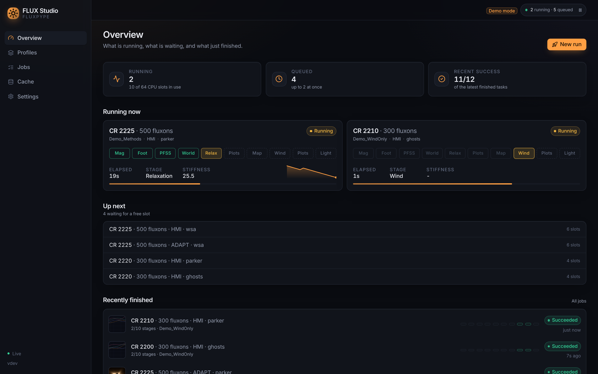

# FLUXpype

[](https://doi.org/10.5281/zenodo.24182704)
[](https://github.com/GillySpace27/fluxpype/actions/workflows/CI.yml)
[](https://github.com/GillySpace27/fluxpype/releases)
[](LICENSE)

## Preamble
This package acts as a wrapper around the Field Line Universal relaXer (FLUX), a solar magnetic field model. This means that it requires the FLUX perl/C software located on Github.

FLUXpype is derived from FLUX ([fluxon-mhd](https://github.com/lowderchris/fluxon-mhd), GPL-2.0, [doi:10.5281/zenodo.7975951](https://doi.org/10.5281/zenodo.7975951)). If you use FLUXpype, please cite both. The DOI badge above is the concept DOI for FLUXpype and always resolves to the latest release.

## Installation

FLUX has two halves: the **core** (a C library with Perl/PDL bindings, in
[fluxon-mhd](https://github.com/lowderchris/fluxon-mhd)) and this **Python wrapper**.

1. **Build the core** by following the guide for your platform in
   [fluxon-mhd/doc](https://github.com/lowderchris/fluxon-mhd/tree/main/doc).
   It is done when, in a *new* terminal, `perl -MPDL -MFlux -e1` prints nothing and returns.

   Build libflux with optimization: the default build has no `-O` flag, and an
   `-O2` build makes every relax about 1.5x faster with byte-identical golden
   output (measured on two fixtures, 1.46x to 1.65x). From the fluxon-mhd checkout:

   ```sh
   make everything CFLAGS="-I../include -g -fPIC -O2"
   ```

   Link-order trap: Perl links with `-L/usr/local/lib` first, so an older
   `/usr/local/lib/libflux.a` is linked silently instead of your new one. Remove
   it first, or install to `/usr/local`. Not yet checked: the pdl half of
   `make everything` with this override, and Mac clang. `flux-doctor` reports the
   optimization level it can read from `libflux.a`.

   > **Warning: do not run `make condaflux` (or `make condauninstall`).**
   > The conda sections of the fluxon-mhd guides
   > ([install-linux.md:57](https://github.com/lowderchris/fluxon-mhd/blob/main/doc/install-linux.md),
   > [install-macos.md:65](https://github.com/lowderchris/fluxon-mhd/blob/main/doc/install-macos.md))
   > tell you to. That target runs `lib/uninstall_condaflux.sh`, which does
   > `rm -rf` on the first folder of `PDLLIB` and of `PERL5LIB` whenever its path
   > contains "flux" (any case; `lib/uninstall_condaflux.sh` lines 14-29).
   > A folder such as `~/vscode/fluxons/my-analysis` or `.../envs/fluxenv/...` is
   > deleted with no prompt. On Ubuntu and Debian, where `/bin/sh` is dash, the
   > target instead stops with `source: not found` and `Error 127`
   > (`Makefile:70` runs `source` under `/bin/sh -c`). The fix belongs in
   > fluxon-mhd and is not made yet.
   >
   > Safe build, from the fluxon-mhd checkout, with the conda env activated so
   > its `perl` is first on `PATH`:
   >
   > ```sh
   > ( unset PL_PREFIX PERL5LIB PDLLIB; FL_PREFIX="$CONDA_PREFIX" make everything )
   > ```
   >
   > The parentheses run it in a subshell, so your own shell keeps its
   > `PERL5LIB` and `PDLLIB`. Not yet checked: whether this build alone lets PDL
   > find the FLUX autoload scripts (`simple_relaxer` and the others in the
   > checkout's `pdl/PDL/`). If a relaxation says it cannot find one, add that
   > folder to `PDLLIB`, for example
   > `export PDLLIB="+$HOME/path/to/fluxon-mhd/pdl/PDL:$PDLLIB"`.
   >
   > With `PL_PREFIX` empty, `Makefile:24` passes an empty `INSTALL_BASE`, so
   > `Flux.pm` is installed into that Perl's own site directory (already on its
   > `@INC`) and no `PERL5LIB` line is needed. This is how the container's
   > reference build was installed. Not yet tried inside a conda env on macOS;
   > check with the `perl -MPDL -MFlux -e1` test above. Whatever you do, check
   > `echo $PERL5LIB $PDLLIB` first and keep your own work out of any folder it lists.
2. **Install fluxpype** (Python 3.10 to 3.12):

   ```sh
   git clone https://github.com/GillySpace27/fluxpype.git
   cd fluxpype
   ./install.sh
   ```

   This creates `./.venv`, installs fluxpype into it, and runs `flux-doctor`,
   which checks Python, Perl, PDL, Flux, gnuplot and the config, and prints
   the fix for anything missing. Run `flux-doctor` again any time.
3. **Set your JSOC email** in `fluxpype/config.ini` (`jsoc_email`) or as
   `JSOC_EMAIL`. JSOC only sends data to registered addresses
   ([register here](http://jsoc.stanford.edu/ajax/register_email.html)).
4. **First run** (one rotation, 100 fluxons, about 10 minutes):

   ```sh
   source .venv/bin/activate
   flux-config-run --config quickstart
   ```

   `flux-config-run` exits nonzero if any job fails, and prints which ones.

## Configuration
Once the code is all installed correctly, you'll be able to edit the configuration file and run it in the following manner.

Editing the configuration file by running the flux-config-edit command is one of the primary ways to interface with the code. The file can also be edited directly. The second line of the config file (`config_name`) selects the default profile; `flux-config-run --config NAME` overrides it for one run. Any settings not redefined in that profile will use the default settings from the first block ("DEFAULT").

To see the details of the current job configuration:
> flux-config-view

To edit the details of the configuration, modify config.ini. You can find that by typing:
> flux-config-edit

## Running
The pipe can be invoked in four ways.

> \% flux-config-run

> \% python3 fluxpype/config_runner.py

> \% python3 fluxpype

> \% python3 \
>\>\>\> from fluxpype.config_runner import run \
>\>\>\> run()


## Fluxpype Plumber

A local web GUI for running and watching the pipeline: choose a profile, override settings for one run, queue tasks, follow stages and relaxation live, browse plots and logs, and clean up cached files.

```bash
pip install -e ".[plumber]"
flux-plumb              # opens http://plumber.localhost:8765 (signed in via a token URL)
flux-plumb --demo       # a throwaway Plumber that only simulates (demo.plumber.localhost:8775); normally just pick Simulated in the UI
flux-plumb --open       # open the running Plumber in the browser, signed in
flux-plumb --status     # address, process and login-item state
flux-plumb --stop       # stop the Plumber for this state directory (running jobs keep running)
```

**Backends.** The switch at the top left of every page chooses where new runs go: **This computer** (real FLUX runs) or **Simulated** (a fake pipeline for trying things out; its outputs go to `<home>/sandbox/data`, never your data folder). SSH and Slurm backends will appear there once they are set up. The status light at the top right opens a panel that checks each part: the server, live updates, the queue, the config, the data folder, and for the real backend the job Python, the science stack, the fluxpype runner and Perl with PDL, run the way a job runs them.

**Presets.** The sections of `config.ini` appear as built-in presets; Plumber never writes that file. New presets (from scratch, a duplicate, or "Save as preset" from a run's changes) are stored in `<home>/presets.ini`, inherit `[DEFAULT]` like any section, and can be edited, renamed, hidden, deleted (restorable), exported as `.ini` and imported. Each preset tile shows how much of its work is already cached, and links to those files on the Cache page.

**Data folder.** Real runs read and write config.ini's `data_dir` unless you choose another folder under Settings, Data folder (or start with `--data-dir PATH`; the choice is kept across restarts). Plumber lists the FLUX data folders it finds next to its checkout (every `<sibling>/fluxpype/fluxpype/data`), and the Presets and Cache pages offer to switch when the current folder is empty but another one holds runs. The Cache page shows which presets use each file and can list the files no preset uses. Click any file there to preview it: images and PDFs as they are, text files (footpoints, worlds) by their first lines, and FITS files by their headers plus an image rendered with the job Python. Pickles are never opened.

Real FLUX jobs need the environment with the science stack and FLUX's Perl. If Plumber lives in its own venv, point jobs at the FLUX one with `--python` (or `$FLUX_PLUMBER_PYTHON`), and start Plumber from a shell where `perl -MPDL -e1` works.

The access token is kept in `<home>/token` (mode 0600) and survives restarts, so bookmarks stay signed in. `--rotate-token` makes a new one. A browser without the token gets a sign-in page. Each state directory uses its own cookie, so the demo and a real Plumber can be open side by side.

### Run Plumber like an app (macOS)

`--install` makes Plumber start at login and keeps it running at `http://plumber.localhost:8765` (a launchd agent). Run it once from a shell where FLUX works, because launchd does not read shell profiles: it records that shell's `PATH` and `PERL5LIB` for the jobs.

```bash
cd ~/vscode/fluxons-plumber/fluxpype
.venv-plumber/bin/python -m fluxpype.plumber.cli --install --python ~/vscode/fluxons/.venv/bin/python
.venv-plumber/bin/python -m fluxpype.plumber.cli --open
```

Then add the Dock icon from the browser: in Safari, **File > Add to Dock**; in Chrome, the install icon at the right end of the address bar. The icon is just the browser's link to the running server, so there is nothing extra to update. If Plumber is down, the window says so and retries every 10 s. `--uninstall` removes the login item; `--status` shows the agent, the address and the interpreter and Perl the jobs use.

Only one Plumber runs per state directory (a lock file enforces it); a second `flux-plumb` prints where the first is and exits with status 3. `--headless` runs without a browser or stdout output and logs to `<home>/server.log`.

Plumber binds to 127.0.0.1 only. On a remote machine use an SSH tunnel (`ssh -L 8765:localhost:8765 host`, then open `http://plumber.localhost:8765`). It never writes `config.ini`; per-run overrides are applied to a snapshot copy. The terminal behavior of `flux-config-run` is unchanged unless the Plumber environment variables are set. See `docs/gui/PLAN.md` and `docs/gui/EVENTS.md`.

Frontend sources live in `fluxpype/plumber/web` (React, TypeScript, Vite, Tailwind). The built bundle in `dist/` is committed, so users do not need Node. To rebuild: `cd fluxpype/plumber/web && npm ci && npm run build`.

### MCP server

`flux-plumb-mcp` lets an AI assistant (Claude Code, Claude Desktop, any MCP client) look at and drive Plumber: submit jobs, wait for stages, read logs and relaxation curves, look at plots. It is a client of Plumber's local API, speaks MCP over stdio, and finds (or, if none is running, starts) the Plumber for your state directory. Tools, safety notes and the autostart lifetime are in [docs/mcp/TOOLS.md](docs/mcp/TOOLS.md).

The quickest way to connect an agent: open Plumber, click **Connect agent** in the top bar (also under Settings), and paste the copied prompt into your agent. The prompt carries this Plumber's exact Python and state directory, checks whether the MCP SDK is installed, and asks the agent to register the server and confirm the connection without starting any jobs. It contains no token. The same prompt is available from a terminal:

```bash
cd ~/vscode/fluxons-plumber/fluxpype
.venv-plumber/bin/python -m fluxpype.plumber.mcp_server --print-prompt
```

To set it up by hand instead, install the extra into the same environment you use for Plumber:

```bash
cd ~/vscode/fluxons-plumber/fluxpype
.venv-plumber/bin/pip install -e ".[mcp]"
```

Claude Code:

```bash
cd ~/vscode/fluxons-plumber/fluxpype
claude mcp add fluxpype -- "$PWD/.venv-plumber/bin/python" -m fluxpype.plumber.mcp_server
```

Claude Desktop (`claude_desktop_config.json`; use the absolute path of the venv's Python):

```json
{
  "mcpServers": {
    "fluxpype": {
      "command": "/home/you/vscode/fluxons-plumber/fluxpype/.venv-plumber/bin/python",
      "args": ["-m", "fluxpype.plumber.mcp_server"],
      "cwd": "/home/you/vscode/fluxons-plumber/fluxpype"
    }
  }
}
```

A Plumber started this way keeps running after the assistant exits, because its jobs must. Stop it with:

```bash
cd ~/vscode/fluxons-plumber/fluxpype
.venv-plumber/bin/flux-plumb --stop
```

Running jobs are detached and keep going; the next Plumber picks them up. Options: `--home PATH`, `--url` with `--token-file` for an already running local Plumber, `--no-autostart`, and `--demo` (needs `--home`) for a simulated pipeline.



## Contributing

This project welcomes contributions and suggestions. For details, visit the repository's [Contributor License Agreement (CLA)](https://cla.opensource.microsoft.com) and [Code of Conduct](https://opensource.microsoft.com/codeofconduct/) pages.
